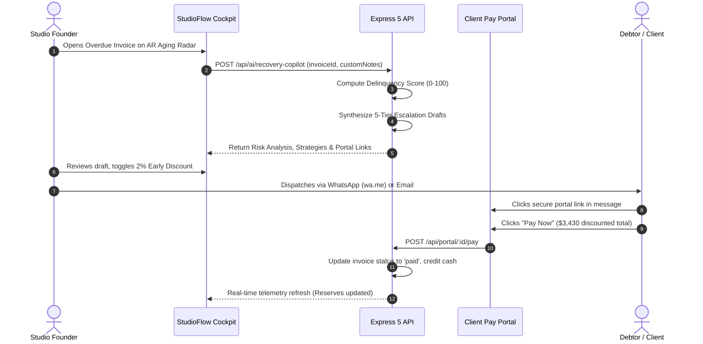

# StudioFlow — The One-Person Back Office

> **An intelligent cash-flow runway cockpit, accounts receivable aging radar, and AI-powered late-payment recovery copilot for freelance designers and solo creative studios.**

🚀 **Live Production Deployment:** [https://codebenders-qus9.vercel.app](https://codebenders-qus9.vercel.app)

[](https://codebenders-qus9.vercel.app)
[](https://github.com/Abhiman12406/Codebenders-.git)

[](https://vitejs.dev/)
[](https://react.dev/)
[](https://expressjs.com/)
[](https://tailwindcss.com/)
[](file:///C:/Users/Asus/Desktop/Codebenders/server/test-api.js)
[](LICENSE)

---

## Table of Contents

1. [Problem Statement](#1-problem-statement)
2. [Research & Market Insights](#2-research--market-insights)
3. [Solution: StudioFlow](#3-solution-studioflow)
4. [Architecture & Technical Design](#4-architecture--technical-design)
5. [Deployment & Operations](#5-deployment--operations)
6. [Local Development & Verification](#6-local-development--verification)
7. [Judge Walkthrough Script](#7-judge-walkthrough-script)

---

## 1. Problem Statement

Small businesses and solo creative agencies rarely fail from a lack of talent or client demand. **They fail due to cash-flow timing mismatches.** 

```
┌────────────────────────────────────────────────────────────────────────┐
│                        THE CASH MISMATCH DILEMMA                       │
│                                                                        │
│   FIXED OUTFLOWS (Rent, Software, Cloud, Taxes)  ────────►  STRICT DUE │
│   CLIENT RECEIVABLES (Net 15/30/60 Invoices)      ────────►  DELAYED   │
│                                                                        │
│                 Result: Predictable Liquidity Collapse                 │
└────────────────────────────────────────────────────────────────────────┘
```

### The Critical Bottlenecks

1. **The Invoicing Friction Barrier:**
   Traditional accounting tools (QuickBooks, FreshBooks) require multi-step, bureaucratic form-filling with 15+ inputs. Solo operators postpone invoicing until the end of the week or month, introducing artificial delays before the payment clock even starts.

2. **The "Chasing Clients" Emotional Tax:**
   Chasing overdue payments is emotionally exhausting. Solo founders fear that sending assertive reminders will offend clients and destroy lucrative long-term relationships. Conversely, staying polite and passive drains the studio's emergency runway, leaving founders unable to pay their own bills.

3. **Static, Low-Conversion Invoices:**
   Invoices are typically sent as static PDF attachments. Clients open them, intend to pay, but defer because paying requires manual bank transfers, copy-pasting IBANs, or navigating vendor portals. The friction directly inflates debtor delay days.

4. **Blindspot in Cash Forecasting:**
   Accounting software looks backward for tax compliance and historical bookkeeping. Solo operators lack a forward-looking, day-by-day cash projection that incorporates client payment delinquency habits ($DueDate + \Delta$).

5. **Multi-Default "Bad Day" Crises:**
   When 3 to 5 clients delay payment simultaneously right before studio rent and quarterly taxes are due, freelancers panic. They have no systematic triage protocol to recover cash immediately.

---

## 2. Research & Market Insights

### Target Persona
- **Primary Persona:** Solo Freelance Designers, Creative Directors, and Boutique Studio Leads (1–5 person teams).
- **Work Environment:** Operating via WhatsApp, email, Figma, and spreadsheets with zero dedicated accounting or finance staff.

### Key Behavioral Insights

| Research Area | Finding | Product Implication |
|---|---|---|
| **Communication Channels** | Over **85%** of independent designers manage client communication via WhatsApp and direct mobile channels. WhatsApp messages achieve **>90% open rates** within 30 minutes, compared to <20% for formal accounting system emails. | Provide 1-click pre-drafted WhatsApp deep links (`wa.me`) alongside structured email copy. |
| **Why Clients Pay Late** | Invoices stall rarely out of malice; they stall due to accounts payable bureaucracy, missing purchase order numbers, lost emails, or minor questions. | Deliver an interactive Client Payment Portal with itemized deliverables, 1-click checkout simulation, and 7-day extension requests. |
| **Payment Delay Psychology** | Client payment behavior follows distinct historical cohorts: *Fast* (0d lag), *Reliable* (2–4d lag), *Habitual Late* (14d lag), and *Chronic Risk* (28d+ lag). Treating every late client with the same tone is counterproductive. | Model an objective 4-tier Delinquency Risk Scorer that weights days past due against historical client lag and exposure magnitude. |
| **Statutory Protections** | Protections like the *Freelance Isn't Free Act* (mandating payment within 30 days and double damages for non-payment) exist in major jurisdictions, but freelancers rarely cite them due to lack of legal phrasing. | Embed legally calibrated statutory notice drafting into the recovery escalation matrix for accounts 30+ days overdue. |

---

## 3. Solution: StudioFlow

**StudioFlow** is an intelligent, zero-fluff **One-Person Back Office** that turns receivables management and cash survival into an automated, frictionless operational workflow.

```
┌────────────────────────────────────────────────────────────────────────┐
│                        STUDIOFLOW FEATURE SUITE                        │
│                                                                        │
│  [1] Quick Inflow Bar        ►  Natural language invoice drafting      │
│  [2] AR Aging Radar          ►  Cohort breakdown (0-15d, 16-30d, 31-60d)│
│  [3] AI Recovery Copilot     ►  5-tier behavioral negotiation matrix   │
│  [4] Client Pay Portal       ►  1-click payment simulation & PDF layout │
│  [5] Cash Horizon Engine     ►  30-90d curve with interactive What-If  │
│  [6] Bad Day Liquidity Mode  ►  3-tier emergency multi-default triage  │
│  [7] Outflows Ledger         ►  Fixed overhead vs flexible SaaS freeze │
└────────────────────────────────────────────────────────────────────────┘
```

### Core Capabilities

#### 1. Zero-Friction Natural Language Inflow Bar
- Enables 5-second invoice generation by typing plain English:
  > *"Billed Nike brand identity $3,500 due next Friday"*
- Built-in heuristic NLP engine extracts client name, project scope, numerical currency amounts, and calculates relative due dates automatically.
- Includes 1-click creative preset buttons (Brand Identity, UI Sprint, Packaging, Retainer).

#### 2. Accounts Receivable Aging Radar
- Segregates open invoices into clear visual cohorts:
  - **Current** (0–15 days)
  - **Grace Period** (16–30 days)
  - **Overdue** (31–60 days)
  - **Critical Delinquency** (60+ days)
- Instantly surfaces total outstanding AR, at-risk capital, and individual client payment behavior tags.

#### 3. AI Late-Payment Recovery & Negotiation Copilot
- **Debtor Delinquency Risk Scorer (0–100):** Synthesizes days past due, historical client delay, and financial exposure ratio into 4 tiers (*Low, Moderate, High, Critical*).
- **5-Tier Behavioral Escalation Matrix:**
  1. *Friendly Check-in:* Pre-due or Day 0 courtesy reminder confirming receipt.
  2. *Direct Status Inquiry:* Polite 1–7 day late inquiry checking on AP approval.
  3. *Studio Operational Hold:* Assertive 8–21 day late notice pausing active project deliverables.
  4. *Dynamic Settlement & Restructuring:* Negotiates an instant **2% fast-pay discount** or a **50/50 installment split** to unlock emergency liquidity.
  5. *Statutory Legal Demand:* Formal legal notice citing the *Freelance Isn't Free Act* and statutory 1.5%/month interest accrual for 30+ day defaults.
- **Omnichannel Dispatch:** Generates pre-populated WhatsApp mobile links (`wa.me`) and structured email drafts with subject lines and direct payment links.
- **Supervised Autonomy (Human-in-the-Loop):** Studio founders review, customize instructions, or toggle settlement terms before sending. No unapproved automated messages.

#### 4. Interactive Client Pay Portal
- Public-facing, responsive client invoice portal (`/api/portal/:id`).
- Real-time **"Pay Now"** simulation (Card / ACH / UPI) that instantly settles the invoice and credits studio cash reserves.
- Printable PDF invoice layout with CSS `@media print` styling for corporate clients.
- Self-service **"Request 7-Day Extension"** option that logs the extension and updates forecast dates.

#### 5. Dynamic 30–90 Day Cash Horizon with What-If Sliders
- Visual forward projection comparing cumulative invoice inflows against committed recurring bills.
- **Interactive Stress Testing:** Real-time sliders simulate key clients delaying payment by 1–30 days.
- **Predictive Deficit Warnings:** Immediately flags the exact day cash drops below the safety buffer (e.g., *"⚠️ Cash Deficit Alert: -$420 shortfall on Day 24. Action: Chase invoice #104"*).

#### 6. "Bad Day" Liquidity Triage Mode
- Single-click emergency command center when multiple clients delay simultaneously.
- Calculates maximum cash deficit and synthesizes an actionable 3-tier recovery plan:
  - **Tier 1:** 5% fast-settlement discounts on smaller receivables.
  - **Tier 2:** 50% split-payment proposals on anchor client invoices.
  - **Tier 3:** 1-click deferral of non-critical flexible expenses (GPU render farms, SaaS tools).

#### 7. Offline-First Resilience
- The system operates 100% offline using client-side fallback engines and `localStorage` if the backend server is unreachable. Nothing crashes.

---

## 4. Architecture & Technical Design

StudioFlow is built with a decoupled client-server architecture designed for rapid local execution and elastic cloud deployment.

### System Topology

```mermaid
flowchart TD
    subgraph Client ["Frontend Client (Vercel)"]
        UI["React 18 + Tailwind CSS Cockpit"]
        DS["Offline-First dataService.js"]
        CE["Client Forecast Engine"]
        LS[("Browser LocalStorage")]
        UI <--> DS
        DS <--> CE
        DS <--> LS
    end

    subgraph API ["Backend API (Render)"]
        EXP["Express 5 REST API Server"]
        RR["Recovery Risk Scorer"]
        ES["5-Tier Escalation Engine"]
        SE["Settlement & Discount Engine"]
        FE["Cash Forecast Engine"]
        NLP["Natural Language Parser"]
        JSONStore[("Store (server/data/db.json)")]

        EXP --> RR
        EXP --> ES
        EXP --> SE
        EXP --> FE
        EXP --> NLP
        EXP <--> JSONStore
    end

    subgraph Database ["Cloud Persistence (Optional)"]
        Supa[("Supabase PostgreSQL + RLS")]
    end

    UI -->|HTTPS /api/* (VITE_API_URL)| EXP
    DS -.->|Direct Sync when configured| Supa
```

### Data Flow & Supervised Recovery Cycle



### Technology Stack

| Layer | Technologies | Purpose |
|---|---|---|
| **Frontend Framework** | React 18, Vite 6 | High-speed component rendering, SPA reactivity, fast HMR |
| **Styling & Icons** | Tailwind CSS 3, Lucide React | High-density fintech aesthetic, responsive layout, dark-mode styling |
| **Motion & Micro-interactions** | GSAP 3, `@gsap/react` | Smooth horizon curves, interactive slider feedback |
| **Backend Framework** | Node.js, Express 5 | High-throughput REST API, JSON parsing, error routing |
| **Engines & Business Logic** | Custom ES Modules (`server/engine/`) | Delinquency risk scoring, escalation matrix, cash projection, NLP parsing |
| **Persistence** | Synchronous JSON Store + Supabase (PostgreSQL) | Zero-setup local demo store with seamless cloud database sync |
| **Security & Headers** | CORS, custom security middleware | Origin isolation, XSS protection, anti-clickjacking (`X-Frame-Options: DENY`) |

### Core API Endpoints

All backend routes are mounted under `/api`:

| Method | Endpoint | Description |
|---|---|---|
| `GET` | `/api/health` & `/health` | Health check for uptime monitors and load balancers |
| `GET` | `/api/invoices` | Retrieve all invoices and aging cohorts |
| `POST` | `/api/invoices` | Create a new invoice |
| `PATCH` | `/api/invoices/:id` | Update invoice details or notes |
| `DELETE` | `/api/invoices/:id` | Remove an invoice |
| `GET` | `/api/portal/:id` | Public client portal payload (items, studio profile, payment options) |
| `POST` | `/api/portal/:id/pay` | Simulate client payment; marks invoice paid and credits cash balance |
| `POST` | `/api/portal/:id/extension` | Request a 7-day payment extension with logged reason |
| `GET` | `/api/forecast?horizonDays=N` | Cash balance trajectory over 30, 60, or 90 days |
| `GET` | `/api/triage` | Multi-default deficit analysis and 3-tier action plan |
| `GET` | `/api/outflows` | Retrieve committed bills and flexible overhead |
| `POST` | `/api/outflows` | Create a recurring bill |
| `PUT` | `/api/outflows/:id` | Update bill details or toggle flexible flag |
| `DELETE` | `/api/outflows/:id` | Remove an outflow |
| `GET` | `/api/profile` | Retrieve studio settings, runway parameters, and cash buffer |
| `PUT` | `/api/profile` | Update studio name, currency, or starting cash reserves |
| `POST` | `/api/ai/parse` | Natural language text parsing into structured invoice draft |
| `POST` | `/api/ai/recovery-copilot` | Generate risk score and 5-tier escalation drafts |
| `POST` | `/api/ai/outreach-log` | Log debtor outreach attempt to audit trail |

---

## 5. Deployment & Operations

StudioFlow is configured for seamless deployment to **Render** (Express API) and **Vercel** (Vite React Frontend).

```
                            DEPLOYMENT ARCHITECTURE
                            
    GitHub: Abhiman12406/Codebenders-
       │
       ├──► Vercel (Frontend Client) ──► Builds dist/ via vercel.json
       │      │
       │      └── Environment: VITE_API_URL ──────────────┐
       │                                                  ▼
       └──► Render (Backend API)     ──► Runs server/ via render.yaml
              │
              └── Health Check: /api/health
```

### Step 1: Deploy Backend to Render

1. Log in to [Render Dashboard](https://dashboard.render.com).
2. Click **New +** → **Blueprint** and select your repository `https://github.com/Abhiman12406/Codebenders-.git` (Render will automatically detect [render.yaml](file:///C:/Users/Asus/Desktop/Codebenders/render.yaml)).
   *Alternatively, choose **Web Service** with manual setup:*
   - **Runtime:** `Node`
   - **Build Command:** `npm install`
   - **Start Command:** `npm start`
   - **Health Check Path:** `/api/health`
3. Add Environment Variables:
   - `NODE_ENV`: `production`
   - `CLIENT_URL`: `https://your-studioflow.vercel.app` *(or leave blank initially)*
4. Click **Create Web Service**.
5. Once deployment completes, copy your live Render URL (e.g. `https://studioflow-api.onrender.com`).
6. Test endpoint:
   ```bash
   curl -I https://studioflow-api.onrender.com/api/health
   # HTTP/1.1 200 OK -> {"status":"ok"}
   ```

### Step 2: Deploy Frontend to Vercel

1. Log in to [Vercel Dashboard](https://vercel.com).
2. Click **Add New...** → **Project** and import `Abhiman12406/Codebenders-`.
3. Vercel automatically applies [vercel.json](file:///C:/Users/Asus/Desktop/Codebenders/vercel.json):
   - **Framework:** `Vite`
   - **Build Command:** `npm run build`
   - **Output Directory:** `dist`
4. In **Environment Variables**, add:
   - `VITE_API_URL`: `https://studioflow-api.onrender.com` *(Your Render URL)*
   - *(Optional)* `VITE_SUPABASE_URL`: Your Supabase Project URL
   - *(Optional)* `VITE_SUPABASE_ANON_KEY`: Your Supabase Anon Public Key
5. Click **Deploy**.
6. **Live Production URL:** [https://codebenders-qus9.vercel.app](https://codebenders-qus9.vercel.app)

### Step 3: Lock Down CORS (Production Polish)
In your Render Dashboard settings for `studioflow-api`, set `CLIENT_URL` to your Vercel URL (`https://codebenders-qus9.vercel.app`). Render will redeploy instantly with scoped CORS protection.

### Environment Variables Summary

| Variable | Platform | Required | Purpose |
|---|---|:---:|---|
| `NODE_ENV` | Render | Yes | Enables production performance mode (`production`) |
| `PORT` | Render | Optional | Handled automatically by Render (defaults to 3001) |
| `CLIENT_URL` | Render | Recommended | Restricts CORS to your specific Vercel frontend domain (`https://codebenders-qus9.vercel.app`) |
| `VITE_API_URL` | Vercel | Yes | Directs API requests to your live Render backend service |
| `VITE_SUPABASE_URL` | Vercel | Optional | Supabase database URL for multi-device sync |
| `VITE_SUPABASE_ANON_KEY` | Vercel | Optional | Supabase anonymous API public key |

---

## 6. Local Development & Verification

### Prerequisites
- Node.js 18.0.0 or higher
- npm 9.0.0 or higher

### Quick Start

```bash
# 1. Clone repository
git clone https://github.com/Abhiman12406/Codebenders-.git
cd Codebenders-

# 2. Install dependencies
npm install

# 3. Start both backend API (port 3001) and frontend Vite server (port 5173)
npm run dev
```

Open [http://localhost:5173](http://localhost:5173) in your browser. The top telemetry bar will display **"🟢 API Connected (Port 3001)"**.

### Scripts Reference

| Command | Action |
|---|---|
| `npm run dev` | Runs Express API (`server/index.js`) and Vite client concurrently |
| `npm test` | Runs the full 32-check backend API and offline copilot test suite |
| `npm run build` | Compiles the production React application into `dist/` |
| `npm run preview` | Serves the production build locally for verification |
| `node server/index.js` | Runs the Express API standalone on port 3001 |
| `node test-dataService.js` | Executes the offline-first data layer verification suite |

### Pre-Flight Verification Checks

```bash
# Run backend & copilot tests
npm test

# Run data service verification
node test-dataService.js

# Build production bundle
npm run build
```

---

## 7. Judge Walkthrough Script

A 3-minute evaluation guide for hackathon judges and reviewers:

| Time | Feature / Flow | Action & Talking Point |
|---|---|---|
| **0:00 – 0:30** | **Studio Telemetry & Cockpit** | Point to the header telemetry bar displaying starting cash ($6,556.73), calculated runway (days), buffer health ($1,500 safety reserve), and live backend status (`API Connected`). |
| **0:30 – 1:00** | **AR Aging Radar** | Review the accounts receivable cohorts (Current, Grace, Overdue, Critical). Highlight how client payment behavioral tags (*habitual_late*, *chronic_risk*) calculate debtor risk. |
| **1:00 – 1:40** | **AI Recovery Copilot** | Click **"Recovery Copilot"** on an overdue debtor (e.g. Acme Studios, 12 days late). Show the Delinquency Risk score. Toggle the **2% Fast-Pay Discount** to watch the real-time settlement calculation ($3,500 → $3,430). Click **"Chase on WhatsApp"** to preview the pre-drafted message with embedded portal link. |
| **1:40 – 2:10** | **Interactive Client Pay Portal** | Click **"View as Client"** on any invoice. View the itemized deliverables. Click **"Pay Now"** (instant simulation) and show how studio cash balance in the header updates immediately. |
| **2:10 – 2:35** | **Natural Language Quick Inflow** | In the quick input bar, enter: `Billed Nike brand design $3,200 due next Friday`. Confirm the parsed draft invoice is added to the ledger in 1 click. |
| **2:35 – 3:00** | **Cash Horizon & Bad Day Triage** | Switch to the Cash Forecast tab. Drag the What-If payment delay slider past day 15 to trigger the **Cash Deficit Alert**. Click **"🚨 BAD DAY"** to review the 3-tier emergency multi-default recovery plan. |

---

## License

This project is licensed under the MIT License — see the [LICENSE](LICENSE) file for details.
